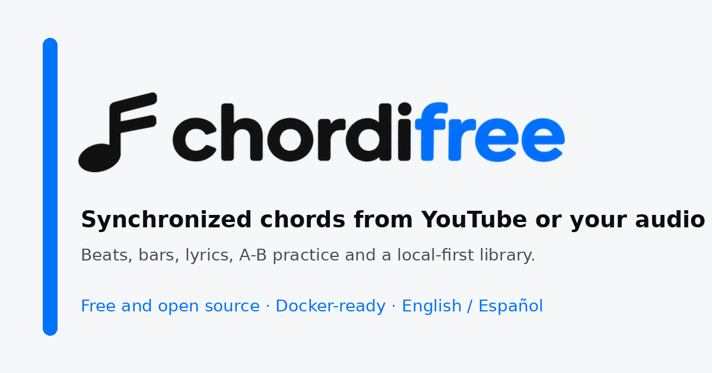

# Chordifree

Turn a YouTube video or your own audio file into a synchronized chord timeline you can
practice with. Chordifree estimates the key, beats, bars and chords, aligns lyrics with the
sung sections, labels the song structure (intro, verse, chorus) so you can jump between
sections while practicing, and lets you correct everything in the browser. It includes a
karaoke-style instrumental, microphone feedback and a multi-track MIDI export; the desktop
build can add local stem separation, synchronize the four stems in a mixer and transcribe the
bass and drums for the MIDI export. Run it locally, or deploy a private online instance where
only approved Google accounts can sign in and each user's library is stored in their account.

Built by [Moisés Lodeiro](https://github.com/moiseslodeiro), from a musician to musicians.



> **Legal notice**: downloading YouTube audio may violate its Terms of Service. Use the
> audio-upload option when you do not own the content. Chordifree does not bypass technical
> restrictions or use session cookies.

## Two ways to run it

| Mode                 | Sign-in                            | Library                                  | Best for                               |
| -------------------- | ---------------------------------- | ---------------------------------------- | -------------------------------------- |
| Local / desktop      | None                               | Browser local storage or the desktop app | Practice on one machine, offline use   |
| Private online (GCP) | Google, restricted to an allowlist | Firestore, per user                      | A small multi-device instance you host |

Local mode is the default and stays account-free. The online mode is opt-in: it does not
remove the local library or the desktop workflow.

## Quick start with Docker

Requirements: Docker Engine or Docker Desktop with Compose v2, and an internet connection for
the first build (the analyzer downloads its ONNX models).

```bash
git clone https://github.com/moiseslodeiro/chordifree.git
cd chordifree
docker compose up --build -d
```

If your Docker installation only provides the standalone binary, use
`docker-compose up --build -d` instead. The `Makefile` detects both.

Open **http://localhost:3000**.

Useful commands:

```bash
make logs      # follow logs
make down      # stop
make up        # rebuild and start
make clean     # stop and remove volumes
```

The first build can take a few minutes because it installs Essentia, ONNX Runtime, ffmpeg,
yt-dlp and the voice-detection models. The first analysis is also slower than the rest.

### VPS with HTTPS

The Compose stack binds the web container to `127.0.0.1:3000`, so it is not exposed directly.
Put Caddy (or another reverse proxy) in front of it:

```bash
sudo apt install caddy
sudo cp deploy/Caddyfile.example /etc/caddy/Caddyfile
# edit the domain, then:
sudo systemctl reload caddy
```

Caddy obtains and renews the TLS certificate automatically. Open only ports 80 and 443 in the
VPS firewall; do not expose 3000, 3001 or 8000.

When the app is behind a proxy, set `CORS_ORIGIN` to the public origin (for example
`https://app.example.com`) so same-origin writes pass the CSRF guard.

### Private hosted instance on GCP

The [`deploy/gcp`](deploy/gcp/README.md) stack adds an optional online mode:

- **Google sign-in** verified server-side with `google-auth-library`.
- **Admin-managed allowlist** in Firestore. `ADMIN_EMAILS` bootstraps the administrators and
  they are always allowed; everyone else must be added from the web UI (`#/admin`).
- **Per-user cloud library** under `chordifree_users/{uid}`. Songs and setlists merge with
  the local copy by song source and `updatedAt`.
- **Collaborative songs:** share a song with a link, and every signed-in account on the
  allowlist can edit it. Each save keeps a version with the author's nickname; you can open
  the history, compare the changes and load any version. A stale save is rejected instead of
  overwriting the newer work.
- **Nickname:** chosen on first sign-in and editable in the account menu.
- **Admin activity**: administrators see which songs were analyzed, when, and by which
  account.
- **Account deletion:** from the account menu, a user can delete their cloud library. A
  non-admin also loses allowlist access; the local copy stays on the device.
- **Private analyzer** on Cloud Run. Only the server service account can invoke it, using a
  Cloud Run ID token.
- **Scale to zero** and a free-tier-friendly shape: no load balancer, no IAP, no always-on
  VM. Cloud Run, Firestore and Artifact Registry are provisioned by Terraform.

Quick start (the full guide covers OAuth, origins, cost and troubleshooting):

```bash
cd deploy/gcp
cp terraform.tfvars.example terraform.tfvars
# fill in project_id, google_client_id and admin_emails
gcloud auth login
gcloud auth application-default login
./deploy.sh
```

Set `AUTH_MODE=google` for the online mode. The default `AUTH_MODE=none` keeps local and
desktop behaviour unchanged.

Operations, logs, Firestore backups, token rotation and the cost/stop checklist are in
[`docs/OPERATIONS.md`](docs/OPERATIONS.md).

> **YouTube on cloud hosts:** YouTube often blocks datacenter and Cloud Run IPs with a
> “confirm you're not a bot” challenge. The audio-upload path always works; configure cookies
> or a proxy only if you understand the terms and the operational risk.

For a free-ish workaround, [`services/youtube-extractor`](services/youtube-extractor/README.md)
runs `yt-dlp` on a residential IP (a Raspberry Pi is enough) and lets Cloud Run use it for
YouTube probe/search/download. The analyzer stays in Cloud Run.

```bash
cd services/youtube-extractor
sudo ./install.sh          # systemd, recommended for a Pi 2
# or: docker compose up -d --build
```

Then expose `127.0.0.1:8010` with Cloudflare Tunnel or Tailscale Funnel and set
`YOUTUBE_EXTRACTOR_URL` / `YOUTUBE_EXTRACTOR_TOKEN` in Terraform. The complete headless
installation and tunnel walkthrough is in
[`docs/RASPBERRY_PI_EXTRACTOR.md`](docs/RASPBERRY_PI_EXTRACTOR.md).

## Features

- **Chord detection** with Essentia `NNLSChroma`, key estimation and Viterbi smoothing.
- **YouTube search** by name: the results show the thumbnail, channel and duration, and one
  click analyzes the song.
- **Beat grid** with one row per bar, active-beat highlighting, keyboard navigation and a
  time signature you can correct (2/4, 3/4, 4/4).
- **Bar view** with one chord per bar and automatic tempo/phase adjustment.
- **Lyrics view** with approximate timing, vocal-region detection and manual anchors.
- **Practice A-B**: arm A or B, hover to preview a bar, click to mark it without playing, then
  play from A to B or loop the range.
- **Transposition**, English/Spanish notation, sharps/flats, capo, guitar/piano/ukelele.
- **Audio pitch** for uploaded files and temporary YouTube audio (±12 semitones) without
  changing the tempo, plus **karaoke** center-channel vocal removal. YouTube songs show the
  thumbnail and play from the main player bar.
- **Microphone feedback (desktop)**: the sheet listens to your instrument and marks the
  active chord once it matches the timeline. Audio is processed in the browser and never
  recorded.
- **Auto-scroll** inside the grid: playback keeps the active row in view with the next two
  rows visible.
- **Simplify / reduce chords** for simpler accompaniment.
- **Local or private cloud library**: keep songs and setlists in the browser, on the
  desktop, or per-user in Firestore on the optional online instance. Setlists, JSON backups,
  **ChordPro import/export** and print/PDF.
- **Private online access** with Google sign-in, a Firestore allowlist and an admin page;
  only approved accounts can enter.
- **Sharing**: send a chord sheet to WhatsApp, Telegram or email, share a single song file, or
  share/print a complete setlist.
- **Multi-track MIDI**: export the chords and pad from the analysis plus the transcribed
  bass and drums from the stems as a Standard MIDI File.
- **Local stem separation (desktop)**: an optional plugin separates vocals, drums, bass and
  other; a mixer plays the four synchronized tracks with independent volume, and the
  **Stems** screen lists jobs, cancels them and manages the persistent cache. See
  [`docs/STEMS_PLUGIN.md`](docs/STEMS_PLUGIN.md).
- **Performance mode**: full screen chord sheet with the editing chrome out of the way.
- **Cache manager** in the library for the analysis cache and temporary YouTube audio, plus
  **Stems** (`#/stems`) for separated tracks and running jobs, with their storage size and
  clear buttons.
- **English and Spanish interface**, English by default.

## Stems, karaoke and MIDI (desktop)

The karaoke toggle works everywhere: it removes the center channel to approximate an
instrumental. Pitch (±12 semitones) changes the audio without touching the chords; both apply
to the original track.

On desktop, `STEMS_PLUGIN_DIR` enables real separation. The song view shows a **Stems** card
inside the collapsible **Audio** section: separate, cancel, play the synchronized mix with one
volume per stem, return to the original track, download a WAV or build a MIDI from the stems.
Jobs keep running when you change songs or close the view. Completed separations are cached in
`$TEMP_DIR/stems-cache` (20 entries / 2 GB, oldest evicted first) and managed from `#/stems`
(**Pistas** in the header), including cancellation, playback of a cached mix or a single stem
and cache cleanup. The plugin is not bundled with the installer.

## Local development

Requirements: Node.js 22.22+ or 24.15+, pnpm 9+, Python 3.11+, ffmpeg and yt-dlp.

```bash
pnpm install
cp .env.example .env

# Terminal 1: analyzer
python3 -m venv .venv
. .venv/bin/activate
pip install -r services/analyzer/requirements.txt
uvicorn app.main:app --app-dir services/analyzer --port 8001

# Terminal 2: web + API
pnpm dev
```

Open **http://localhost:5173**.

The analyzer downloads its ONNX models on the first analysis. To prefetch them, see
[`services/analyzer/models/README.md`](services/analyzer/models/README.md). Set
`ANALYZER_DOWNLOAD_MODELS=0` in production and bake the models into the image instead.

## Configuration

Copy `.env.example` to `.env` and adjust as needed.

| Variable                   | Default                 | Purpose                                                                                                        |
| -------------------------- | ----------------------- | -------------------------------------------------------------------------------------------------------------- |
| `PORT`                     | `3001`                  | Express API port                                                                                               |
| `HOST`                     | `127.0.0.1`             | Bind address; use `0.0.0.0` only inside a container or behind a proxy                                          |
| `CORS_ORIGIN`              | `http://localhost:5173` | Allowed browser origin                                                                                         |
| `ANALYZER_URL`             | `http://localhost:8001` | Internal analyzer URL                                                                                          |
| `MAX_DURATION_SECONDS`     | `900`                   | Maximum audio/video length                                                                                     |
| `MAX_UPLOAD_BYTES`         | `26214400`              | Maximum upload size (25 MB)                                                                                    |
| `RATE_LIMIT_MAX`           | `60`                    | Analysis requests per window and IP                                                                            |
| `RATE_LIMIT_WINDOW_MS`     | `3600000`               | Rate-limit window                                                                                              |
| `TRUST_PROXY`              | `0`                     | Trusted reverse-proxy hops; set `1` behind nginx/Caddy                                                         |
| `TEMP_DIR`                 | `./.tmp`                | Temporary audio and analysis working directory                                                                 |
| `AUDIO_CACHE_TTL_MINUTES`  | auto                    | Temporary YouTube audio retention. `0` keeps it until cleared; defaults to `0` on localhost and `60` elsewhere |
| `STEMS_PLUGIN_DIR`         | empty                   | Optional local stems plugin for desktop. See `docs/STEMS_PLUGIN.md`                                            |
| `STEMS_SERVICE_URL`        | empty                   | Optional remote stems service, preferred over the local plugin. See `docs/STEMS_PLUGIN.md`                     |
| `YTDLP_PATH`               | `yt-dlp`                | yt-dlp binary                                                                                                  |
| `FFMPEG_PATH`              | `ffmpeg`                | ffmpeg binary                                                                                                  |
| `FFPROBE_PATH`             | `ffprobe`               | ffprobe binary                                                                                                 |
| `ANALYZER_VERSION`         | `essentia-1.6`          | Cache-busting analyzer version                                                                                 |
| `ANALYZER_DOWNLOAD_MODELS` | `1`                     | Allow runtime model download                                                                                   |
| `AUTH_MODE`                | `none`                  | `none` for local/desktop, `google` for the hosted allowlisted instance                                         |
| `GOOGLE_CLIENT_ID`         | empty                   | OAuth Web client ID used to verify Google ID tokens                                                            |
| `ADMIN_EMAILS`             | empty                   | Comma-separated administrators; always allowed and able to manage access                                       |
| `GOOGLE_CLOUD_PROJECT`     | empty                   | Project for Firestore (allowlist and cloud libraries)                                                          |
| `FIRESTORE_DATABASE`       | `(default)`             | Firestore database ID                                                                                          |
| `ANALYZER_AUTH`            | `token`                 | `google` makes the server call the analyzer with a Cloud Run ID token                                          |
| `ANALYZER_TOKEN`           | empty                   | Shared token when `ANALYZER_AUTH=token`                                                                        |

## Architecture

```text
Local / Docker
  Browser (React + Vite)
    -> nginx / Express API
         -> FastAPI analyzer (Essentia + ONNX Runtime)
         -> yt-dlp + ffmpeg (YouTube or upload)

Private online (GCP, optional)
  Browser
    -> Cloud Run: Express API + SPA
         -> Cloud Run: private analyzer (ID-token auth)
         -> Firestore: allowlist + per-user libraries
```

- `apps/web`: React SPA, local library, lyrics alignment, practice tools.
- `apps/server`: Express API, upload handling, YouTube download, temporary audio cache,
  job queue.
- `services/analyzer`: FastAPI + Essentia + NNLSChroma + YAMNet/voice ONNX models.
- `packages/chords`: chord model, notation, transposition and reduction.

The Docker Compose setup publishes **only port 3000**. The API and analyzer are reachable only
inside the Compose network.

## Tests

```bash
pnpm typecheck
pnpm lint
pnpm -r test
pnpm --filter @chordifree/web exec playwright test
.venv/bin/python -m pytest services/analyzer/tests
```

The end-to-end suite needs Playwright browsers installed
(`pnpm --filter @chordifree/web exec playwright install`).

## Desktop app (experimental)

A local desktop build is being explored in `packaging/`:

- `packaging/analyzer`: PyInstaller spec for the FastAPI analyzer sidecar.
- `packaging/electron`: Electron shell that starts the analyzer and the bundled
  Express server on random local ports, serves the built web app and protects the
  analyzer with a per-launch token.
- `.github/workflows/desktop-builds.yml`: builds the Windows analyzer and NSIS
  installer, the macOS arm64/x64 DMGs and ZIPs, and the Linux AppImage and `.deb`,
  then publishes them on tags. The workflow produces `chordifree-analyzer-windows`,
  `chordifree-macos-arm64`, `chordifree-macos-x64` and `chordifree-linux-x64`.

The desktop builds are validated end to end (`/health`, audio analysis and the
`C/F/G` smoke test). The workflow stages the analyzer, web app, server and media
binaries. Essentia does not publish an official Windows wheel, so the workflow
builds one from the open Windows-wheel PR and applies small compatibility
patches. On macOS and Linux it uses the official Essentia wheels. See the READMEs
in `packaging/analyzer` and `packaging/electron` for build steps and limitations.

### Windows installer

The **Desktop builds** workflow runs manually, so it does not consume CI minutes on
every push. It builds the installer and writes `SHA256SUMS.txt`:

```bash
gh workflow run desktop-builds.yml --ref main
```

To publish a GitHub release, dispatch the same workflow on a version tag; the
release job only runs for `refs/tags/v*`:

```bash
git tag v0.5.0
git push origin v0.5.0
gh workflow run desktop-builds.yml --ref v0.5.0
```

The executable is unsigned, so SmartScreen warns on first launch. See
[`docs/WINDOWS_INSTALL.md`](docs/WINDOWS_INSTALL.md) for checksum verification, the
**More info → Run anyway** flow and uninstall steps.

### macOS installer

The same manual run also builds two macOS installers:

- `chordifree-<version>-arm64.dmg` (Apple Silicon, macOS 15+)
- `chordifree-<version>-x64.dmg` (Intel, macOS 13+; pending for the first preview)

They are ad-hoc signed and not notarized, so Gatekeeper asks the user to allow the
app in **System Settings → Privacy & Security**. See
[`docs/MACOS_INSTALL.md`](docs/MACOS_INSTALL.md) for checksum verification, the
Gatekeeper flow and uninstall steps.

### Linux installer

The same manual run also builds an x86_64 Linux build:

- `chordifree-<version>-x86_64.AppImage`
- `chordifree-<version>-amd64.deb`

The AppImage may need FUSE (`libfuse2` or `libfuse2t64`); the `.deb` installs with
`apt`. ARM64 Linux is not supported yet because Essentia does not publish an arm64
Linux wheel. See [`docs/LINUX_INSTALL.md`](docs/LINUX_INSTALL.md) for checksum
verification, FUSE and uninstall steps.

Code signing and automatic installation of updates are still pending. The packaged
desktop app does check the latest GitHub release on startup and shows a dismissible
notice with a download link; set `CHORDIFREE_DISABLE_UPDATE_CHECK=1` to disable the
check. Only the app version and the public GitHub release metadata are involved.

## Landing page (GitHub Pages)

The project site lives in `site/` and is plain HTML, CSS and a small JavaScript file.
It has no build step. `.github/workflows/pages.yml` publishes it on every push to `main`
that changes `site/`.

To preview it locally:

```bash
python3 -m http.server 8088 -d site
```

Then open **http://localhost:8088**. To publish, enable GitHub Pages with
**Source: GitHub Actions** in the repository settings. Pages for a private repository
requires a plan that includes it.

## Troubleshooting

- **Analyzer is down**: check `docker compose logs analyzer` and open
  `http://localhost:3000/api/health`. The analyzer needs its two ONNX models; keep
  `ANALYZER_DOWNLOAD_MODELS=1` in local development or bake them into the image.
- **First analysis is slow**: the analyzer loads Essentia and the voice models into memory.
- **YouTube video fails**: it may be private, region-locked, age-restricted or longer than
  `MAX_DURATION_SECONDS`. Try the audio-upload tab.
- **Apple Silicon**: the Essentia wheel is built for Linux x86-64. Docker Desktop will use
  emulation; add `platform: linux/amd64` to the analyzer service if needed.
- **Port already in use**: change the host port in `docker-compose.yml` and update
  `CORS_ORIGIN` if you call the API directly.
- **`KeyError: ContainerConfig` with `docker-compose` 1.29**: this is a known bug in the old
  standalone Compose with recent Docker versions. Run `docker-compose down` and then
  `docker-compose up -d`, or install Compose v2 and use `docker compose`.
- **`GET /v1/models` 404 lines in the analyzer log**: a local tool expects an OpenAI-compatible
  server on port 8000, which is the vLLM default. The development analyzer listens on 8001 for
  that reason; the Docker analyzer keeps 8000 inside the Compose network, where it is not
  reachable from the host.

## Licenses and commercial use

- The application code is released under **AGPL-3.0** (see [`LICENSE`](LICENSE)).
- **Essentia** is AGPL-3.0. If you expose the analyzer over a network, you must publish the
  source of the modified analyzer and the combined work.
- **YAMNet** is Apache-2.0.
- The Essentia **voice/instrumental** classifier is **CC BY-NC-SA 4.0** (non-commercial).
  Do not use it in a paid product without a commercial license or a replacement model.
- Downloading YouTube audio may violate YouTube's Terms of Service. This project is intended
  for personal experimentation and for audio you own.

Spanish documentation: [`README.es.md`](README.es.md).

## Project policies

- [Security policy](SECURITY.md)
- [Privacy](PRIVACY.md)
- [Terms of use](TERMS.md)

---

<sub>Chordifree · AGPL-3.0 · Built by [Moisés Lodeiro](https://github.com/moiseslodeiro) · Built with [Essentia](https://essentia.upf.edu/) · [GitHub](https://github.com/moiseslodeiro/chordifree) · [Documentación en español](README.es.md)</sub>
