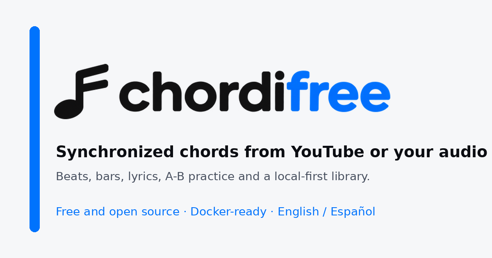

# Chordifree

Turn a YouTube video or your own audio file into a synchronized chord timeline you can
practice with. Chordifree estimates the key, beats, bars and chords, aligns lyrics with the
sung sections, and lets you correct everything in the browser.

Built by [Moisés Lodeiro](https://github.com/moiseslodeiro), from a musician to musicians.



> **Legal notice**: downloading YouTube audio may violate its Terms of Service. Use the
> audio-upload option when you do not own the content. Chordifree does not bypass technical
> restrictions or use session cookies.

## Quick start with Docker

Requirements: Docker Engine or Docker Desktop with Compose v2, and an internet connection for
the first build (the analyzer downloads its ONNX models).

```bash
git clone https://github.com/moiseslodeiro/chordifree.git
cd chordifree
docker compose up --build -d
```

If your Docker installation only provides the standalone binary, use
`docker-compose up --build -d` instead. The `Makefile` detects both.

Open **http://localhost:3000**.

Useful commands:

```bash
make logs      # follow logs
make down      # stop
make up        # rebuild and start
make clean     # stop and remove volumes
```

The first build can take a few minutes because it installs Essentia, ONNX Runtime, ffmpeg,
yt-dlp and the voice-detection models. The first analysis is also slower than the rest.

### VPS with HTTPS

The Compose stack binds the web container to `127.0.0.1:3000`, so it is not exposed directly.
Put Caddy (or another reverse proxy) in front of it:

```bash
sudo apt install caddy
sudo cp deploy/Caddyfile.example /etc/caddy/Caddyfile
# edit the domain, then:
sudo systemctl reload caddy
```

Caddy obtains and renews the TLS certificate automatically. Open only ports 80 and 443 in the
VPS firewall; do not expose 3000, 3001 or 8000.

When the app is behind a proxy, set `CORS_ORIGIN` to the public origin (for example
`https://app.example.com`) so same-origin writes pass the CSRF guard.

## Features

- **Chord detection** with Essentia `NNLSChroma`, key estimation and Viterbi smoothing.
- **YouTube search** by name: the results show the thumbnail, channel and duration, and one
  click on **Chordifree** loads the song.
- **Beat grid** with one row per bar, active-beat highlighting and keyboard navigation.
- **Bar view** with one chord per bar and automatic tempo/phase adjustment.
- **Lyrics view** with approximate timing, vocal-region detection and manual anchors.
- **Practice A-B**: arm A or B, hover to preview a bar, click to mark it without playing, then
  play from A to B or loop the range.
- **Transposition**, English/Spanish notation, sharps/flats, capo, guitar/piano/ukelele.
- **Simplify / reduce chords** for simpler accompaniment.
- **Local library** stored in the browser, with folders to group songs, JSON backups,
  **ChordPro import/export** and print/PDF.
- **Sharing**: send a chord sheet to WhatsApp, Telegram or email, share a single song file, or
  share/print a complete setlist.
- **Performance mode**: full screen chord sheet with the editing chrome out of the way.
- **Analysis cache manager** in the library, with storage size and a clear button.
- **English and Spanish interface**, English by default.

## Local development

Requirements: Node.js 22.22+ or 24.15+, pnpm 9+, Python 3.11+, ffmpeg and yt-dlp.

```bash
pnpm install
cp .env.example .env

# Terminal 1: analyzer
python3 -m venv .venv
. .venv/bin/activate
pip install -r services/analyzer/requirements.txt
uvicorn app.main:app --app-dir services/analyzer --port 8001

# Terminal 2: web + API
pnpm dev
```

Open **http://localhost:5173**.

The analyzer downloads its ONNX models on the first analysis. To prefetch them, see
[`services/analyzer/models/README.md`](services/analyzer/models/README.md). Set
`ANALYZER_DOWNLOAD_MODELS=0` in production and bake the models into the image instead.

## Configuration

Copy `.env.example` to `.env` and adjust as needed.

| Variable | Default | Purpose |
|---|---|---|
| `PORT` | `3001` | Express API port |
| `HOST` | `127.0.0.1` | Bind address; use `0.0.0.0` only inside a container or behind a proxy |
| `CORS_ORIGIN` | `http://localhost:5173` | Allowed browser origin |
| `ANALYZER_URL` | `http://localhost:8001` | Internal analyzer URL |
| `MAX_DURATION_SECONDS` | `900` | Maximum audio/video length |
| `MAX_UPLOAD_BYTES` | `26214400` | Maximum upload size (25 MB) |
| `RATE_LIMIT_MAX` | `60` | Analysis requests per window and IP |
| `RATE_LIMIT_WINDOW_MS` | `3600000` | Rate-limit window |
| `TRUST_PROXY` | `0` | Trusted reverse-proxy hops; set `1` behind nginx/Caddy |
| `TEMP_DIR` | `./.tmp` | Temporary audio directory |
| `YTDLP_PATH` | `yt-dlp` | yt-dlp binary |
| `FFMPEG_PATH` | `ffmpeg` | ffmpeg binary |
| `FFPROBE_PATH` | `ffprobe` | ffprobe binary |
| `ANALYZER_VERSION` | `essentia-1.6` | Cache-busting analyzer version |
| `ANALYZER_DOWNLOAD_MODELS` | `1` | Allow runtime model download |

## Architecture

```text
Browser (React + Vite)
  -> nginx / Express API
       -> FastAPI analyzer (Essentia + ONNX Runtime)
       -> yt-dlp + ffmpeg (YouTube or upload)
```

- `apps/web`: React SPA, local library, lyrics alignment, practice tools.
- `apps/server`: Express API, upload handling, YouTube download, job queue.
- `services/analyzer`: FastAPI + Essentia + NNLSChroma + YAMNet/voice ONNX models.
- `packages/chords`: chord model, notation, transposition and reduction.

The Docker Compose setup publishes **only port 3000**. The API and analyzer are reachable only
inside the Compose network.

## Tests

```bash
pnpm typecheck
pnpm lint
pnpm -r test
pnpm --filter @chordifree/web exec playwright test
.venv/bin/python -m pytest services/analyzer/tests
```

The end-to-end suite needs Playwright browsers installed
(`pnpm --filter @chordifree/web exec playwright install`).

## Desktop app (experimental)

A local desktop build is being explored in `packaging/`:

- `packaging/analyzer`: PyInstaller spec for the FastAPI analyzer sidecar.
- `packaging/electron`: Electron shell that starts the analyzer and the bundled
  Express server on random local ports, serves the built web app and protects the
  analyzer with a per-launch token.
- `.github/workflows/desktop-builds.yml`: builds the Windows analyzer and NSIS
  installer, the macOS arm64/x64 DMGs and ZIPs, and the Linux AppImage and `.deb`,
  then publishes them on tags. The workflow produces `chordifree-analyzer-windows`,
  `chordifree-macos-arm64`, `chordifree-macos-x64` and `chordifree-linux-x64`.

The desktop builds are validated end to end (`/health`, audio analysis and the
`C/F/G` smoke test). The workflow stages the analyzer, web app, server and media
binaries. Essentia does not publish an official Windows wheel, so the workflow
builds one from the open Windows-wheel PR and applies small compatibility
patches. On macOS and Linux it uses the official Essentia wheels. See the READMEs
in `packaging/analyzer` and `packaging/electron` for build steps and limitations.

### Windows installer

The **Desktop builds** workflow runs manually, so it does not consume CI minutes on
every push. It builds the installer and writes `SHA256SUMS.txt`:

```bash
gh workflow run desktop-builds.yml --ref main
```

To publish a GitHub release, dispatch the same workflow on a version tag; the
release job only runs for `refs/tags/v*`:

```bash
git tag v0.2.0
git push origin v0.2.0
gh workflow run desktop-builds.yml --ref v0.2.0
```

The executable is unsigned, so SmartScreen warns on first launch. See
[`docs/WINDOWS_INSTALL.md`](docs/WINDOWS_INSTALL.md) for checksum verification, the
**More info → Run anyway** flow and uninstall steps.

### macOS installer

The same manual run also builds two macOS installers:

- `chordifree-<version>-arm64.dmg` (Apple Silicon, macOS 15+)
- `chordifree-<version>-x64.dmg` (Intel, macOS 13+; pending for the first preview)

They are ad-hoc signed and not notarized, so Gatekeeper asks the user to allow the
app in **System Settings → Privacy & Security**. See
[`docs/MACOS_INSTALL.md`](docs/MACOS_INSTALL.md) for checksum verification, the
Gatekeeper flow and uninstall steps.

### Linux installer

The same manual run also builds an x86_64 Linux build:

- `chordifree-<version>-x86_64.AppImage`
- `chordifree-<version>-amd64.deb`

The AppImage may need FUSE (`libfuse2` or `libfuse2t64`); the `.deb` installs with
`apt`. ARM64 Linux is not supported yet because Essentia does not publish an arm64
Linux wheel. See [`docs/LINUX_INSTALL.md`](docs/LINUX_INSTALL.md) for checksum
verification, FUSE and uninstall steps.

Code signing and automatic installation of updates are still pending. The packaged
desktop app does check the latest GitHub release on startup and shows a dismissible
notice with a download link; set `CHORDIFREE_DISABLE_UPDATE_CHECK=1` to disable the
check. Only the app version and the public GitHub release metadata are involved.


## Landing page (GitHub Pages)

The project site lives in `site/` and is plain HTML, CSS and a small JavaScript file.
It has no build step. `.github/workflows/pages.yml` publishes it on every push to `main`
that changes `site/`.

To preview it locally:

```bash
python3 -m http.server 8088 -d site
```

Then open **http://localhost:8088**. To publish, enable GitHub Pages with
**Source: GitHub Actions** in the repository settings. Pages for a private repository
requires a plan that includes it.

## Troubleshooting

- **Analyzer is down**: check `docker compose logs analyzer` and open
  `http://localhost:3000/api/health`. The analyzer needs its two ONNX models; keep
  `ANALYZER_DOWNLOAD_MODELS=1` in local development or bake them into the image.
- **First analysis is slow**: the analyzer loads Essentia and the voice models into memory.
- **YouTube video fails**: it may be private, region-locked, age-restricted or longer than
  `MAX_DURATION_SECONDS`. Try the audio-upload tab.
- **Apple Silicon**: the Essentia wheel is built for Linux x86-64. Docker Desktop will use
  emulation; add `platform: linux/amd64` to the analyzer service if needed.
- **Port already in use**: change the host port in `docker-compose.yml` and update
  `CORS_ORIGIN` if you call the API directly.
- **`KeyError: ContainerConfig` with `docker-compose` 1.29**: this is a known bug in the old
  standalone Compose with recent Docker versions. Run `docker-compose down` and then
  `docker-compose up -d`, or install Compose v2 and use `docker compose`.
- **`GET /v1/models` 404 lines in the analyzer log**: a local tool expects an OpenAI-compatible
  server on port 8000, which is the vLLM default. The development analyzer listens on 8001 for
  that reason; the Docker analyzer keeps 8000 inside the Compose network, where it is not
  reachable from the host.

## Licenses and commercial use

- The application code is released under **AGPL-3.0** (see [`LICENSE`](LICENSE)).
- **Essentia** is AGPL-3.0. If you expose the analyzer over a network, you must publish the
  source of the modified analyzer and the combined work.
- **YAMNet** is Apache-2.0.
- The Essentia **voice/instrumental** classifier is **CC BY-NC-SA 4.0** (non-commercial).
  Do not use it in a paid product without a commercial license or a replacement model.
- Downloading YouTube audio may violate YouTube's Terms of Service. This project is intended
  for personal experimentation and for audio you own.

Spanish documentation: [`README.es.md`](README.es.md).

## Project policies

- [Security policy](SECURITY.md)
- [Privacy](PRIVACY.md)
- [Terms of use](TERMS.md)


---

<sub>Chordifree · AGPL-3.0 · Built by [Moisés Lodeiro](https://github.com/moiseslodeiro) · Built with [Essentia](https://essentia.upf.edu/) · [GitHub](https://github.com/moiseslodeiro/chordifree) · [Documentación en español](README.es.md)</sub>
