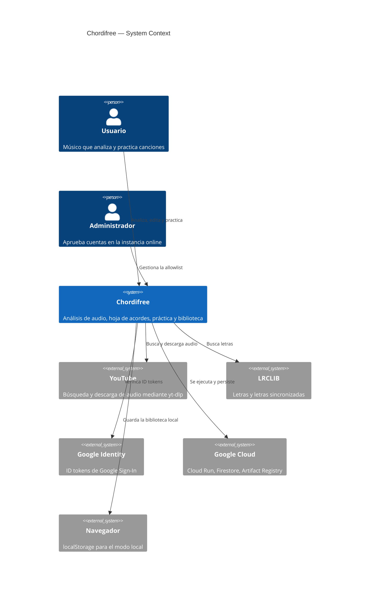
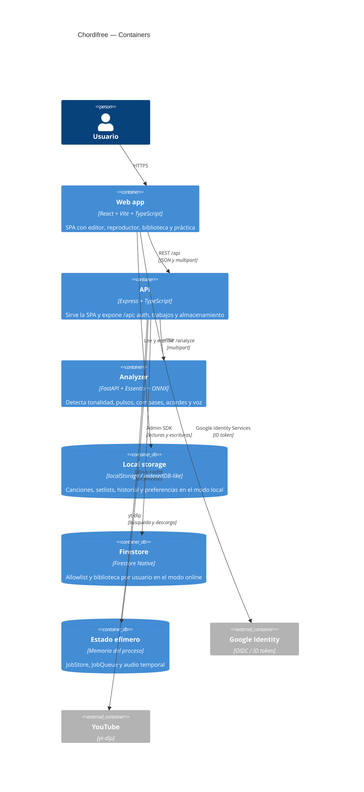
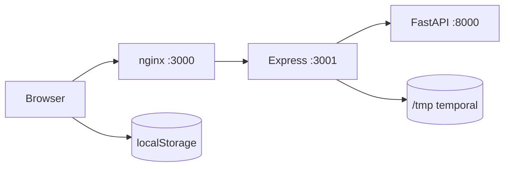
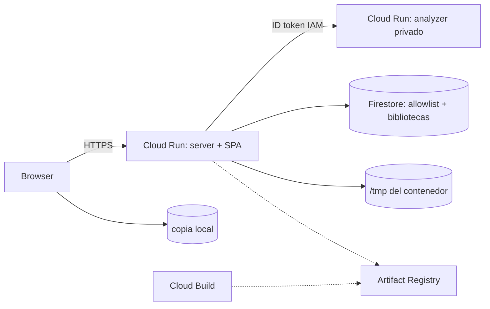

# 01 — Arquitectura del sistema (C4)

> Documentación retrospectiva generada a partir del código. Las marcas `[INFERRED]` señalan
> deducciones que conviene validar con el equipo.

## 1. Contexto

Chordifree convierte una canción de YouTube o un archivo de audio en una hoja de acordes
sincronizada. El producto tiene dos modos:

- **Local / escritorio:** sin cuentas; la biblioteca vive en el navegador o en la app.
- **Online privado:** Google Sign-In, allowlist gestionada por un administrador y biblioteca
  por usuario en Firestore. Se despliega con Terraform en Google Cloud.

### Nivel 1 — Contexto del sistema

### Nivel 2 — Contenedores

## 2. Topologías de despliegue

### Local / Docker / escritorio

- El contenedor `web` sirve la SPA y hace proxy de `/api` al servidor.
- El servidor también puede servir la SPA si se ejecuta solo (`WEB_DIST`).
- El analizador solo es accesible desde la red de Compose.
- La app de escritorio empaqueta el analizador, ffmpeg y los modelos.

### Online privado en GCP

- Cloud Run escala a cero y usa `max_instance_count = 1` en el servidor porque los jobs y el
  audio temporal viven en memoria.
- El analizador es privado: solo la service account del servidor tiene `roles/run.invoker`.
- No hay load balancer ni IAP; el servidor es público a nivel de red y aplica la allowlist en
  Express.
- Terraform crea Cloud Run, Firestore, Artifact Registry, service accounts e IAM.
- **Opcional:** un extractor de YouTube en una IP residencial (Raspberry Pi + túnel) puede
  sustituir al `yt-dlp` local para probe/search/download. El analyzer y la biblioteca siguen en
  Cloud Run. Ver [`../services/youtube-extractor/README.md`](../../services/youtube-extractor/README.md).

## 3. Componentes internos

### `apps/web`

- SPA React con rutas por hash (`home`, `library`, `setlists`, `song`, `admin`).
- `App.tsx` es la composición principal y hoy concentra routing, preferencias, biblioteca,
  setlists, audio, análisis, caché y sincronización con la nube.
- Dominios auxiliares: `storage/`, `player/`, `lyrics/`, `practice/`, `editor/`, `auth/`,
  `lib/api.ts`.
- El modo local se apoya en `localStorage` con envoltorios versionados.

### `apps/server`

- `app.ts` es la raíz de composición: configuración, middleware, rutas y entrega de la SPA.
- `routes/`: analyses, lyrics, youtube, cloud-library, auth y admin (estos dos últimos dentro
  de `services/auth.ts`).
- `services/`: analyzer, analysis, media, lyrics, audio-cache, auth, cloud-library.
- `jobs/`: `JobStore` (estado en memoria) y `JobQueue` (concurrencia acotada).
- `errors.ts`: catálogo de códigos y envelope `{ error: { code, message } }`.

### `services/analyzer`

- FastAPI con `/health` y `/analyze`.
- Essentia + ONNX Runtime; devuelve segmentos, duración, pulsos, compás y regiones vocales.
- Protegido por token compartido en local o por IAM de Cloud Run en producción.

### `packages/chords`

- Modelo canónico de acordes, notación, transposición, simplificación, reducción y segmentos.
- Es la única fuente de verdad del dominio musical compartida entre web y servidor.

## 4. Flujos principales

### Análisis

1. La SPA hace `POST /api/analyses` con JSON (YouTube) o multipart (archivo).
2. El servidor crea un job en memoria y responde `202` con el `AnalysisView`.
3. El job descarga/probee el audio, lo convierte a WAV, lo envía al analizador y normaliza la
   respuesta.
4. La SPA hace polling de `GET /api/analyses/:id`.
5. Al terminar, la SPA guarda la canción en `localStorage` y, en modo online, la sincroniza.

### Sincronización online

1. `AuthProvider` obtiene `/api/auth/config`.
2. Google Identity Services entrega un ID token; se guarda en `sessionStorage`.
3. `GET /api/cloud/library` devuelve el snapshot del usuario.
4. La SPA fusiona canciones por `sourceKey` y setlists por `updatedAt`.
5. `PUT /api/cloud/library` reemplaza el snapshot; hay debounce y un botón de sincronización
   manual.

## 5. Atributos de calidad

| Atributo | Situación actual |
|---|---|
| Coste | Cloud Run scale-to-zero, Firestore free tier, sin LB/IAP. |
| Seguridad | Token verificado en servidor, allowlist, CSP estricta, mismo origen, analyzer privado. |
| Escalabilidad | Limitada por el estado en memoria del servidor y `max_instance_count=1`. |
| Disponibilidad | Cold starts de Cloud Run; los jobs se pierden al reiniciar. |
| Mantenibilidad | Buenas fronteras de servidor/dominio; `App.tsx` es el principal punto de deuda. |
| Observabilidad | `/api/health`, logs de Cloud Run y errores estructurados; sin métricas/tracing. |
| Privacidad | Local por defecto; online con Google y Firestore del propio proyecto. |

## 6. Restricciones y decisiones relevantes

- El servidor está pensado como **monolito modular**, no como microservicios.
- El analizador es el único servicio separado porque tiene un stack y un ciclo de vida
  distintos.
- La biblioteca online es un **snapshot completo por usuario** con last-write-wins.
- `ADMIN_EMAILS` es la fuente de administradores; la allowlist vive en Firestore.
- El estado de Terraform es local por defecto.

Ver decisiones detalladas en [`13-decisiones-tecnicas.md`](13-decisiones-tecnicas.md).
