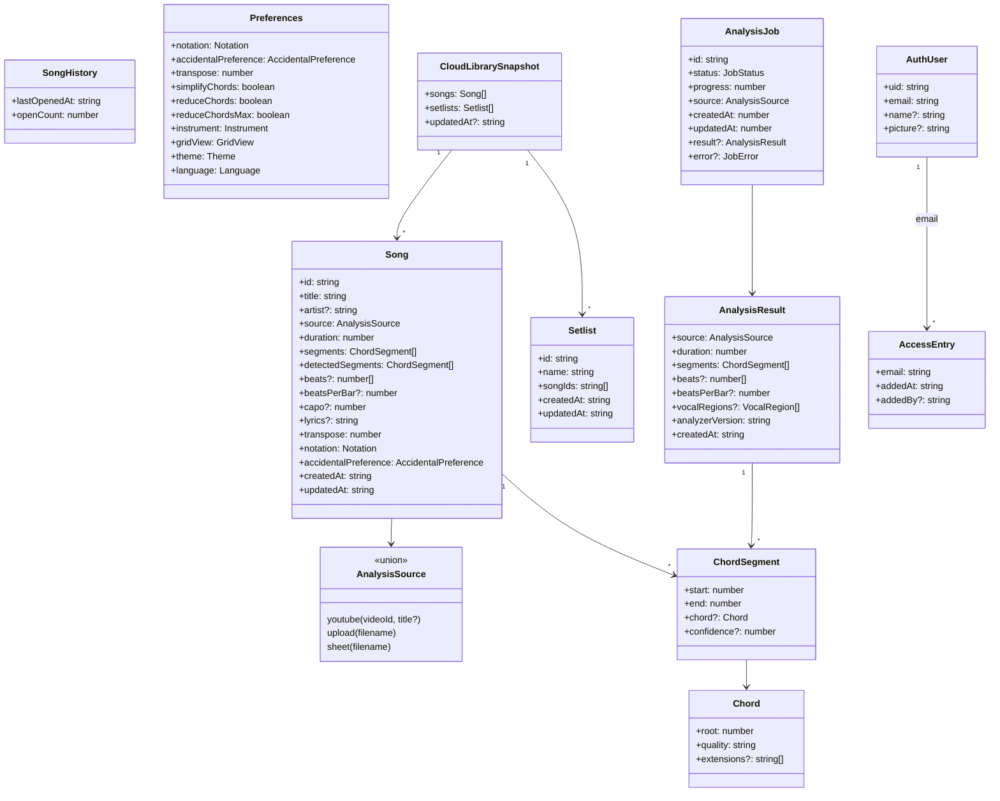

# 03 — Modelo de dominio

Este documento describe el modelo conceptual. Los tipos físicos de Firestore y `localStorage`
están en [`04-diagrama-er.md`](04-diagrama-er.md).

## Entidades y responsabilidades

### Song

Canción guardada por el usuario. Conserva dos versiones de los segmentos:

- `segments`: la versión editable que ve el usuario.
- `detectedSegments`: la detección original, para poder reanalizar o reducir sin perder
  información.

La identidad lógica para fusionar local y nube es `sourceKey(source)`:

- `yt:<videoId>` para YouTube.
- `upload:<filename>` para archivos.
- `sheet:<filename>` para ChordPro.

### ChordSegment / Chord

Un segmento tiene inicio y fin en segundos y un acorde opcional. `Chord` vive en
`packages/chords` y se serializa a JSON. La notación (inglesa/española) y las alteraciones son
preferencias de presentación, no cambian el acorde canónico.

### Setlist

Agrupa IDs de canciones. No contiene copias de las canciones; si una canción se elimina, su ID
queda huérfano y se ignora al abrir la lista.

### SongHistory

Historial de práctica: última apertura y número de veces. Se guarda aparte de la canción para
no ensuciar el documento principal.

### Preferences

Preferencias globales del usuario: notación, alteraciones, transposición, simplificación,
instrumento, vista, tema e idioma. Se guardan en `localStorage`.

### AnalysisJob / AnalysisResult

El job es efímero y vive en memoria. `AnalysisResult` es el contrato que devuelve el analyzer
y que se convierte en `Song` al guardar. El servidor normaliza pulsos, compás, regiones
vocales y segmentos antes de responder.

### AuthUser / AccessEntry

`AuthUser` es el resultado de verificar un ID token de Google. `AccessEntry` es la allowlist de
Firestore. Los administradores se calculan desde `ADMIN_EMAILS`; no se guardan como rol.

### CloudLibrarySnapshot

Representa la biblioteca completa de un usuario en la nube. La API la lee y la reemplaza
entera; la SPA la fusiona con la copia local.

## Reglas de negocio

1. Una canción se identifica para el merge por `sourceKey`, no por `id`.
2. Gana la canción con `updatedAt` más reciente.
3. Gana la setlist con `updatedAt` más reciente.
4. En modo `AUTH_MODE=none` no se accede a Firestore y la biblioteca es local.
5. En modo `google`, toda petición a `/api` (salvo auth/config) exige ID token y allowlist.
6. El administrador siempre está permitido, aunque no esté en `chordifree_access`.
7. Los jobs y el audio temporal no sobreviven a un reinicio del proceso.
8. El snapshot de nube se reemplaza completo; no hay merge por documento en el servidor.

## Estados

- **Job:** `queued → processing → done | error`.
- **Cuenta:** `signed-out → authenticated | denied`; `denied` si Google la autentica pero no
  está en la allowlist.
- **Sincronización:** `idle → syncing → saved | error`.
- **Allowlist:** una entrada existe o no; no tiene estados intermedios.

Ver [`06-diagramas-estado.md`](06-diagramas-estado.md).
