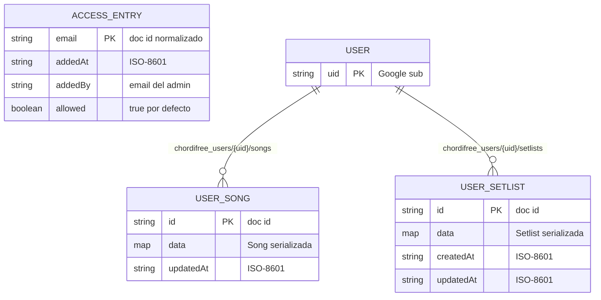
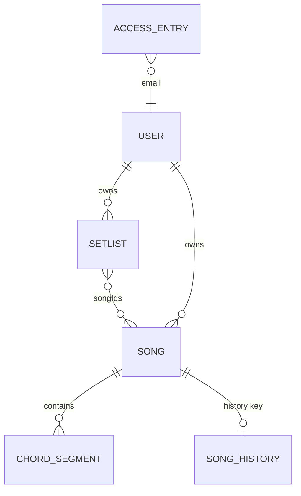

# 04 — Diagrama ER (modelo físico)

Chordifree no usa una base de datos relacional. El modo local usa `localStorage` y el modo
online usa Firestore en modo nativo. El diagrama siguiente representa las colecciones,
documentos y claves locales; los tipos son los que escribe el código.

## Firestore

Rutas reales:

| Ruta | Contenido |
|---|---|
| `chordifree_access/{email}` | `{ email, addedAt, addedBy?, allowed }` |
| `chordifree_users/{uid}/songs/{songId}` | `{ data: Song, updatedAt }` |
| `chordifree_users/{uid}/setlists/{setlistId}` | `{ data: Setlist, updatedAt }` |

Notas:

- Firestore no impone esquema. La validación real es `CloudLibraryBodySchema` en el servidor.
- El `data` de la canción es el objeto `Song` completo; no se descompone en columnas.
- El `id` del documento debe coincidir con `data.id` y no puede contener `/`.
- Los lotes se limitan a 400 escrituras para no superar el límite de 500 de Firestore.
- `deletion_policy = "ABANDON"` en Terraform evita que `terraform destroy` borre la base.

## `localStorage` (modo local)

Prefijo: `chordifree:v1`. Prefijo legado migrado: `freechords:v1`.

| Clave | Tipo | Contenido |
|---|---|---|
| `preferences` | `Preferences` | Notación, tema, idioma, instrumento, etc. |
| `library` | `{ songs: SongSummary[] }` | Índice de canciones |
| `song:{id}` | `Song` | Canción completa |
| `setlists` | `Setlist[]` | Setlists |
| `history` | `Record<songId, SongHistory>` | Última apertura y contador |
| `practice:{id}` | `PracticeState` | Rango A–B, tempo, pitch |
| `analysis:{key}` | `AnalysisResult` | Caché de análisis |
| `corrupt:{timestamp}` | raw | Datos que no se pudieron leer |

Cada valor se envuelve en un sobre versionado (`storage/envelope.ts`) con `schemaVersion` y
`data`. La migración de claves legadas se ejecuta una vez al arrancar.

## Estado en memoria (servidor)

| Estructura | Contenido | Persistencia |
|---|---|---|
| `JobStore.jobs` | `Map<jobId, Job>` | No; TTL 24 h en proceso |
| `JobStore.videoIndex` | `Map<videoId, { jobId, expiresAt, analyzerVersion }>` | No |
| `JobQueue.pending` | tareas FIFO | No |
| `TemporaryAudioCache` | archivos en `TEMP_DIR` | Disco local del contenedor |

## Relaciones lógicas

`SETLIST.songIds` no es una clave foránea: es una lista de IDs que puede contener referencias
huérfanas. La app las ignora al renderizar.

## Índices y consultas

- `chordifree_access`: `orderBy('email')` al listar. Firestore crea el índice automáticamente
  para un campo.
- `chordifree_users/{uid}/songs` y `setlists`: se leen completos (`get()`), sin consultas.
- No hay consultas por rango de fechas ni por acorde; el snapshot completo es suficiente para
  el tamaño actual.
