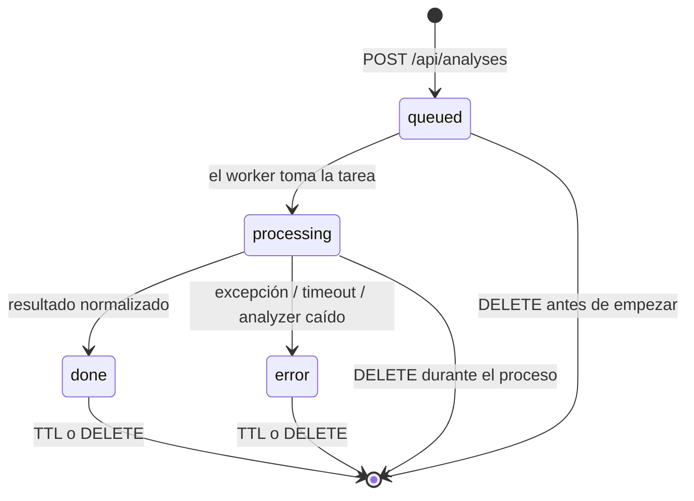
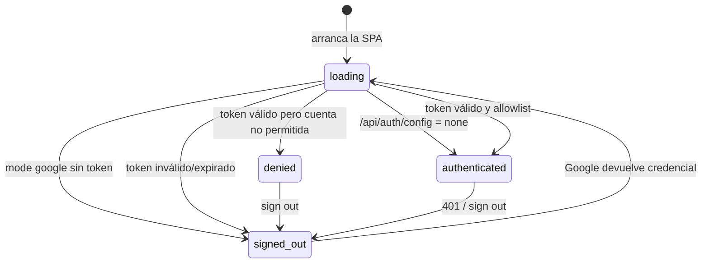
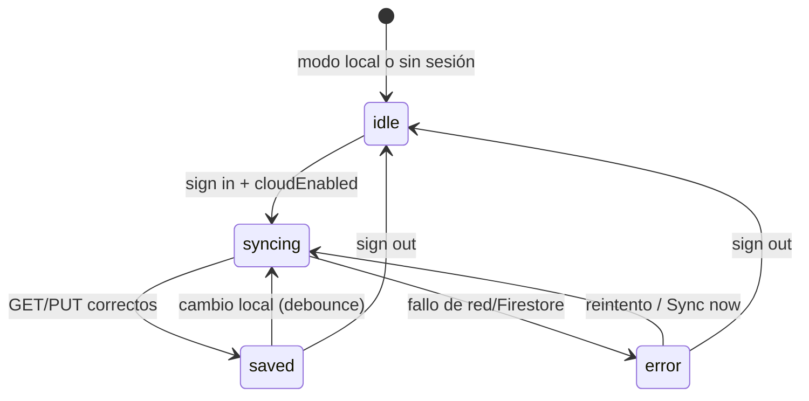
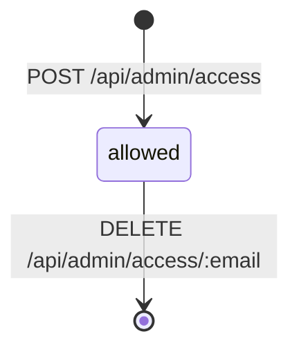
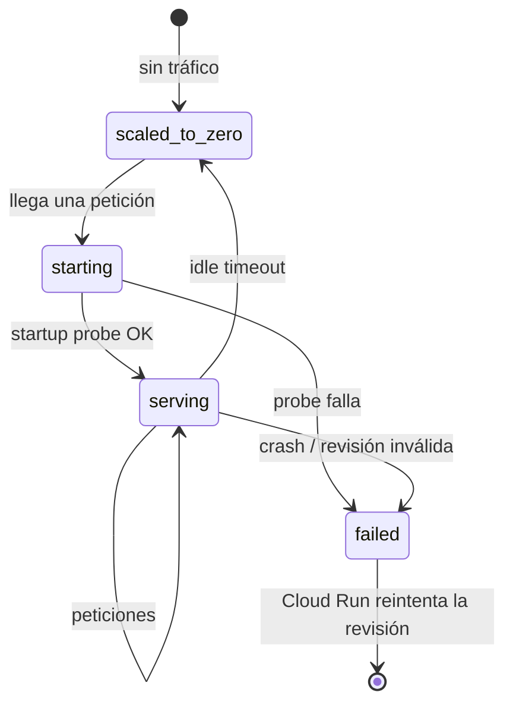

# 06 — Diagramas de estado

## Job de análisis

| Estado | Significado |
|---|---|
| `queued` | Creado y esperando en `JobQueue`. |
| `processing` | Descarga/conversión/análisis en curso. |
| `done` | Tiene `result`; la SPA puede guardar la canción. |
| `error` | Tiene `error: { code, message }`. |

Notas:

- El estado vive en memoria; un reinicio lo pierde.
- `DELETE` elimina el job del `JobStore`; la tarea en curso comprueba que siga existiendo antes
  de escribir el resultado.

## Sesión de autenticación

| Estado | Significado |
|---|---|
| `loading` | Consultando configuración o verificando token. |
| `signed_out` | Sin sesión; se muestra el botón de Google. |
| `denied` | Google autenticó, pero la cuenta no está en la allowlist. |
| `authenticated` | Sesión válida; la app se renderiza. |

## Sincronización de biblioteca

| Estado | Significado |
|---|---|
| `idle` | Sincronización desactivada. |
| `syncing` | Cargando snapshot o guardando cambios. |
| `saved` | Última escritura correcta. |
| `error` | Fallo; se muestra aviso y se conserva la copia local. |

## Allowlist

No hay estados intermedios. `allowed: false` se interpreta como no permitido en
`FirestoreAccessStore.isAllowed`, aunque el flujo normal elimina el documento.

## Servicio Cloud Run

Notas:

- El API usa facturación por solicitud; los análisis se ejecutan como Cloud Run Jobs.
- El estado de cada análisis y los fragmentos temporales de uploads viven en Firestore.
- API, analyzer y Job tienen límites de escalado por instancia/tarea; los Jobs no quedan activos
  después de completar el análisis.
