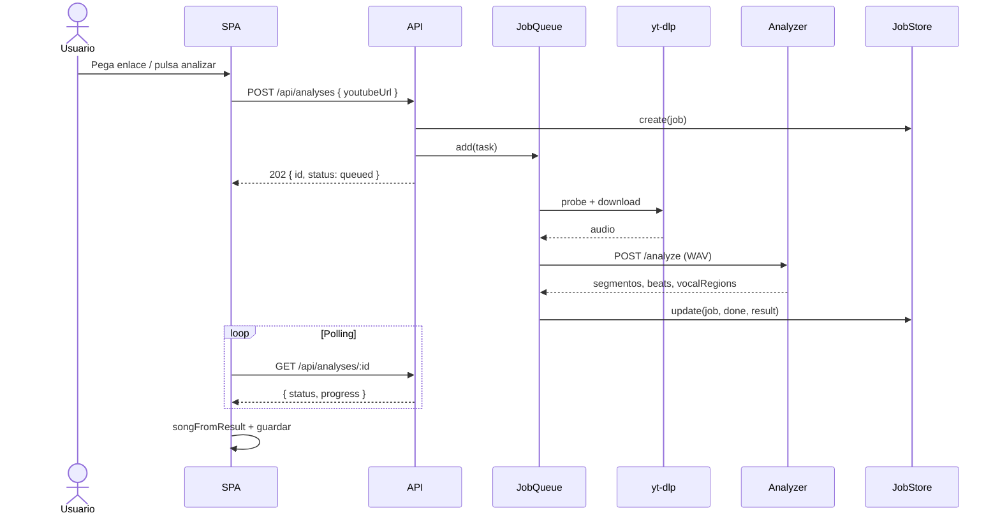
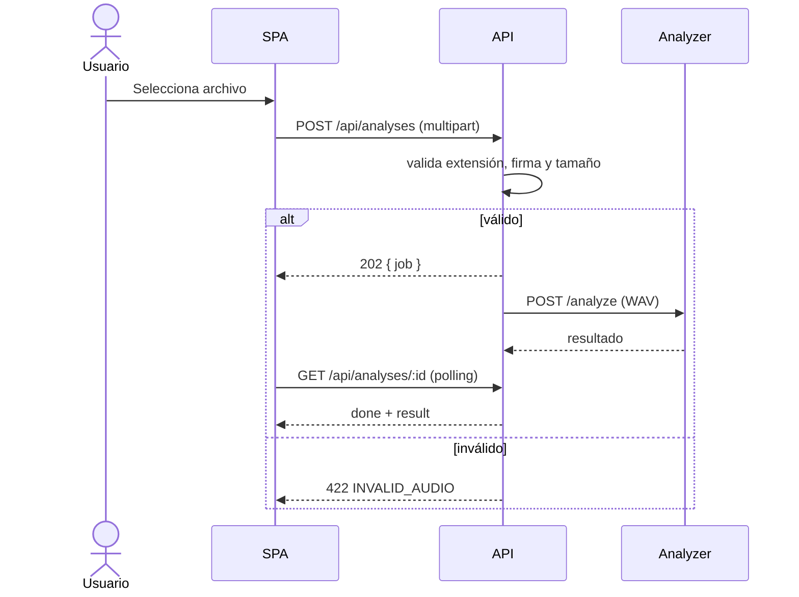
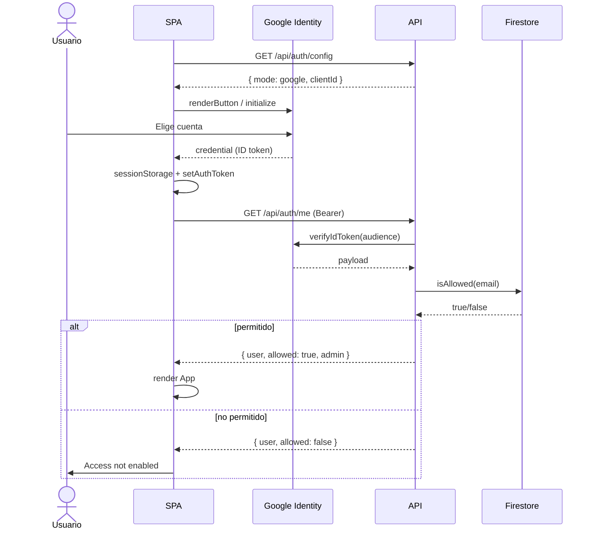
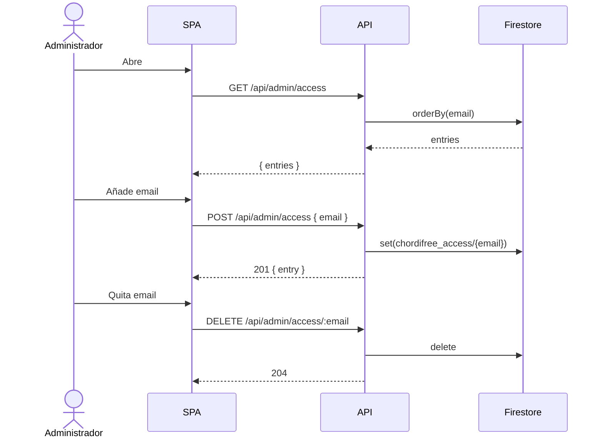
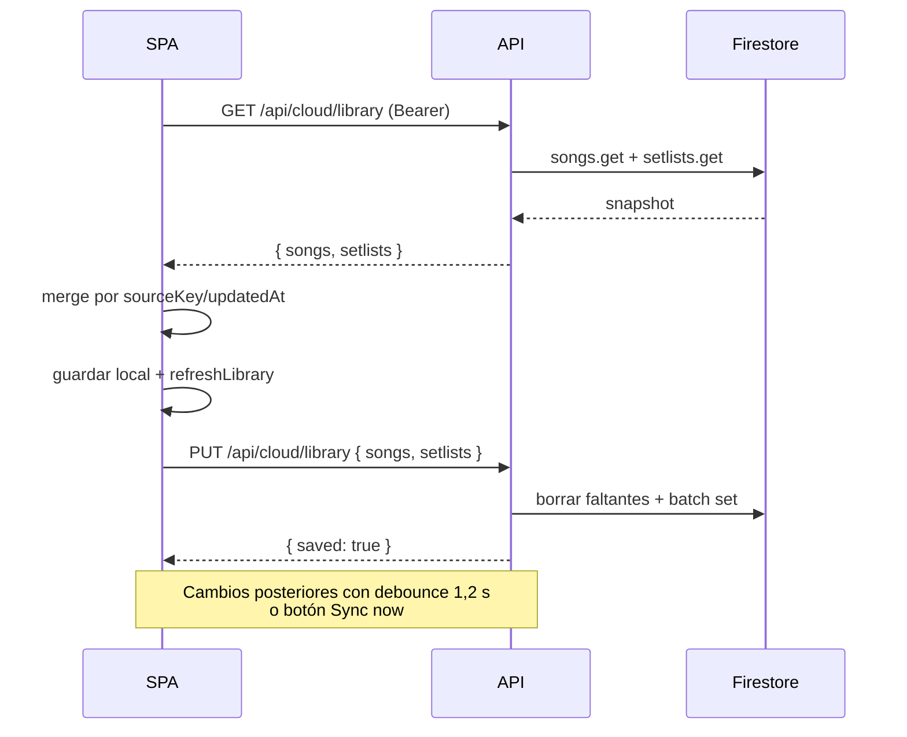
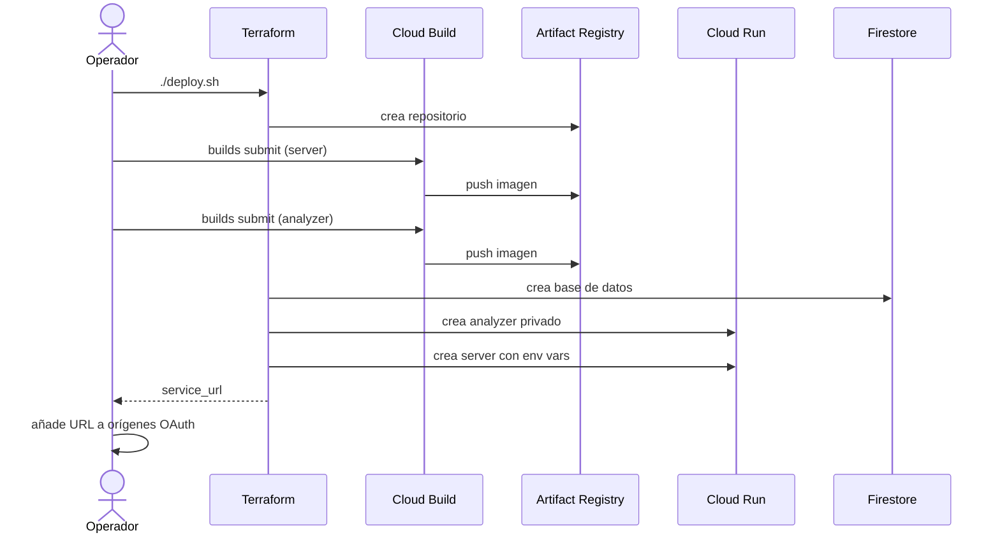
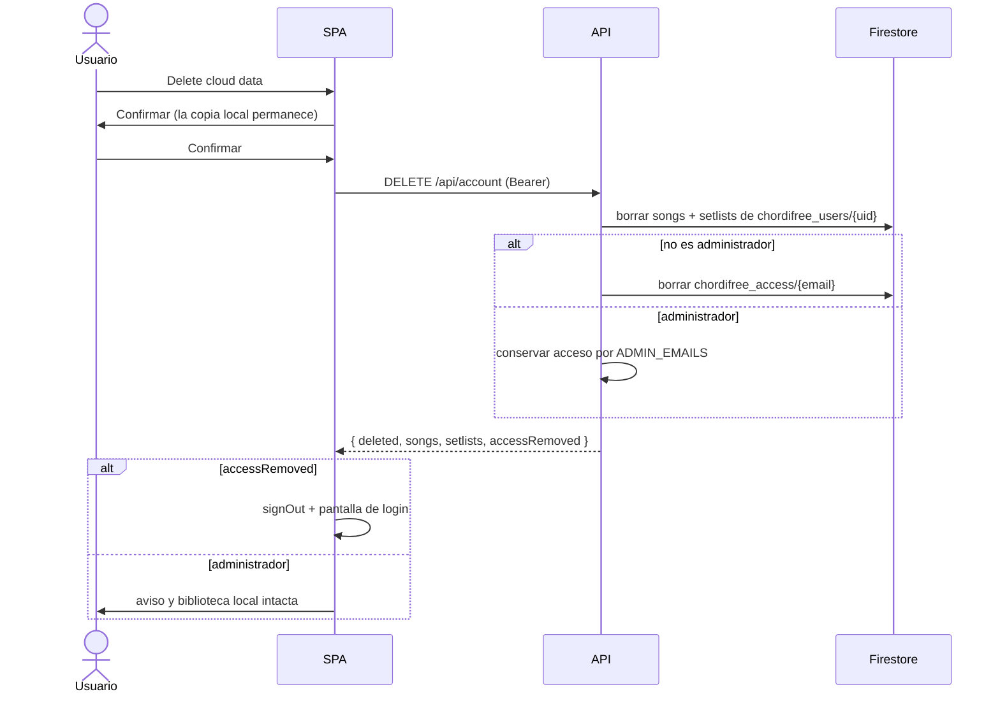

# 09 — Diagramas de secuencia

## CU-001 — Analizar un video de YouTube

**Errores:** el job pasa a `error` si yt-dlp o el analyzer fallan; la SPA muestra el código
localizado y permite reintentar.

## CU-002 — Analizar un archivo

## CU-008 — Login con Google y allowlist

## CU-009 — Gestionar la allowlist

## CU-010 — Sincronizar la biblioteca

**Error:** si el `PUT` falla, la copia local se conserva y la UI muestra `cloud.error`.

## CU-014 — Despliegue

## CU-015 — Borrar datos online y cuenta

