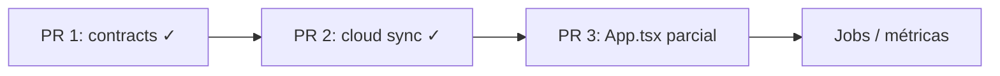

# 14 — Plan de refactor (3 PRs)

Este plan deriva de la documentación anterior y de los riesgos RT-011 y RT-012. El objetivo no
es reescribir la app: es reducir el coste de cambio sin alterar el comportamiento.

## Principios

- Sin cambios de comportamiento visibles.
- Cada PR debe pasar typecheck, lint, tests de servidor/web y E2E.
- Cada PR debe ser reversible.
- No mezclar refactor con features nuevas.
- Mantener el modo local y el online funcionando en cada paso.

## Estado a 2026-11-16

- **PR 1 — contratos:** hecho. `packages/contracts` está integrado en web y servidor.
- **PR 2 — cloud sync:** hecho. `sync/cloud.ts` + `useCloudLibrary` con tests; `setlistsRef` y
  los efectos de nube salieron de `App.tsx`.
- **PR 3 — `App.tsx`:** parcial. De ~996 a ~660 líneas extrayendo routing, preferencias,
  health, actualizaciones de escritorio, caché de audio, header y footer. Queda mover las
  acciones de biblioteca/setlists y las páginas.
- **P0:** privacidad, términos, producto, seguridad, diseño y borrado de cuenta online
  completados.

---

## PR 1 — `packages/contracts`

### Objetivo

Una única fuente de verdad para los tipos y esquemas que cruzan la frontera web ↔ servidor.

### Alcance

- Crear `packages/contracts` con Zod y tipos inferidos:
  - `AnalysisSource`, `AnalysisResult`, `AnalysisView`.
  - `Song`, `Setlist`, `CloudLibrarySnapshot`.
  - `AuthUser`, `AccessEntry`, `AuthConfig`, `AuthMe`.
  - `CloudLibraryBodySchema`.
- Añadir el paquete como dependencia de `apps/web` y `apps/server`.
- Migrar `apps/server/src/types.ts` y `apps/server/src/services/cloud-library.ts` para
  reutilizar los esquemas.
- Migrar `apps/web/src/types.ts` para reexportar o importar los tipos compartidos.
- Mantener `ChordSegment`/`Chord` en `packages/chords`; `contracts` puede importarlos.

### Decisiones

- `AnalysisSource` compartido incluirá `sheet` para no romper el frontend; el servidor seguirá
  aceptando solo `youtube` y `upload` en sus validaciones de entrada.
- Los esquemas de `Song`/`Setlist` serán tolerantes (`passthrough`) para no bloquear campos
  nuevos del frontend.
- No mover lógica de negocio a `contracts`; solo contratos.

### Criterios de aceptación

- [ ] `pnpm typecheck` y `pnpm lint`.
- [ ] Tests de servidor y web sin cambios.
- [ ] `CloudLibraryBodySchema` importado desde `contracts` en el servidor.
- [ ] No quedan definiciones duplicadas de `Song`, `Setlist`, `AnalysisResult` o `AuthUser`.
- [ ] El bundle web no incluye Zod si no se usa en runtime en el cliente (o se justifica).

### Riesgos

- Resolución de workspaces/tsconfig en el paquete nuevo.
- Zod en el bundle del navegador; importar solo tipos cuando sea posible.

**Tamaño:** M · **Riesgo:** bajo · **Orden:** primero.

---

## PR 2 — Extraer la sincronización con la nube

### Objetivo

Sacar el merge y la sincronización de `App.tsx` a módulos puros y un hook testeable.

### Alcance

- `apps/web/src/sync/cloud.ts`:
  - `mergeSongs(local, remote)`: por `sourceKey`, gana `updatedAt`.
  - `mergeSetlists(local, remote)`: por `id`, gana `updatedAt`.
  - `mergeSnapshot(local, remote)`.
- `apps/web/src/sync/useCloudLibrary.ts`:
  - Estado `idle | syncing | saved | error`.
  - Carga inicial, merge, guardado con debounce y `syncNow`.
  - Callback para aplicar el snapshot fusionado a la biblioteca local.
- `App.tsx` consume el hook; se elimina `setlistsRef` y el bloque de efectos de nube.
- Tests unitarios de merge:
  - canción solo local, solo remota, ambas con distinto `updatedAt`.
  - setlist solo local/remota y empate de `updatedAt`.
  - preservación de campos opcionales.
- Test del hook con fake timers (debounce) y fetch mockeado.

### Criterios de aceptación

- [ ] `App.tsx` baja de ~1000 a ~850 líneas (objetivo de este PR).
- [ ] No hay `setlistsRef` ni lógica de merge inline.
- [ ] El modo local no hace peticiones a `/api/cloud`.
- [ ] Al iniciar sesión se carga y fusiona; **Sync now** sigue funcionando.
- [ ] Tests de merge y debounce añadidos.
- [ ] E2E en verde.

### Riesgos

- Bucles de efectos por dependencias de `songs`/`setlists`.
- Condiciones de carrera entre carga inicial y cambios locales.
- Mitigación: funciones puras + un único efecto de carga + debounce testeado.

**Tamaño:** M · **Riesgo:** medio · **Orden:** segundo.

---

## PR 3 — Dividir `App.tsx` por páginas y features

### Objetivo

Convertir `App.tsx` en una composición pequeña y mover el estado a hooks/páginas.

### Alcance

- `apps/web/src/routing/useHashRoute.ts`: parseo, navegación y hash.
- `apps/web/src/hooks/usePreferences.ts`: preferencias, tema, idioma, notación.
- `apps/web/src/hooks/useLibraryData.ts`: lista, apertura, guardado, borrado, import/export.
- `apps/web/src/hooks/useSetlistsData.ts`: CRUD y reordenación.
- `apps/web/src/hooks/useAudioCache.ts`: estadísticas y limpieza.
- `apps/web/src/pages/HomePage.tsx`, `LibraryPage.tsx`, `SongPage.tsx`,
  `SetlistsPage.tsx`, `SetlistPage.tsx`, `AdminPage.tsx`.
- `App.tsx` se queda con layout, providers y switch de ruta; objetivo ≤ 300 líneas.
- Mantener los componentes actuales (`SongView`, `LibraryList`, etc.) sin reescribirlos.

### Criterios de aceptación

- [ ] `App.tsx` ≤ 300 líneas.
- [ ] Ningún archivo nuevo supera ~350 líneas.
- [ ] Cada hook tiene una responsabilidad y no conoce componentes.
- [ ] Typecheck, lint, tests y E2E en verde.
- [ ] Comprobación manual de: home, biblioteca, canción, setlists, admin, import/export,
      práctica A–B, cambio de tema/idioma y sync online.

### Riesgos

- Mover estado puede introducir regresiones sutiles.
- Mitigación: PRs pequeños dentro de la rama, commits por hook/página, E2E después de cada
  bloque.

**Tamaño:** L · **Riesgo:** medio-alto · **Orden:** tercero.

---

## Fuera de alcance (por ahora)

- Persistencia de jobs (RT-001/RT-002).
- Roles en Firestore (RF-024).
- Backend GCS de Terraform (RT-009) — hay ejemplo y runbook, pero no está activado.
- Métricas/tracing (RNF-017).
- División completa de `App.tsx` en páginas.

## Orden de ejecución

Cada PR se abre contra `main`, se revisa y se fusiona antes de empezar el siguiente. No se
apilan para evitar el problema de las ramas encadenadas.
